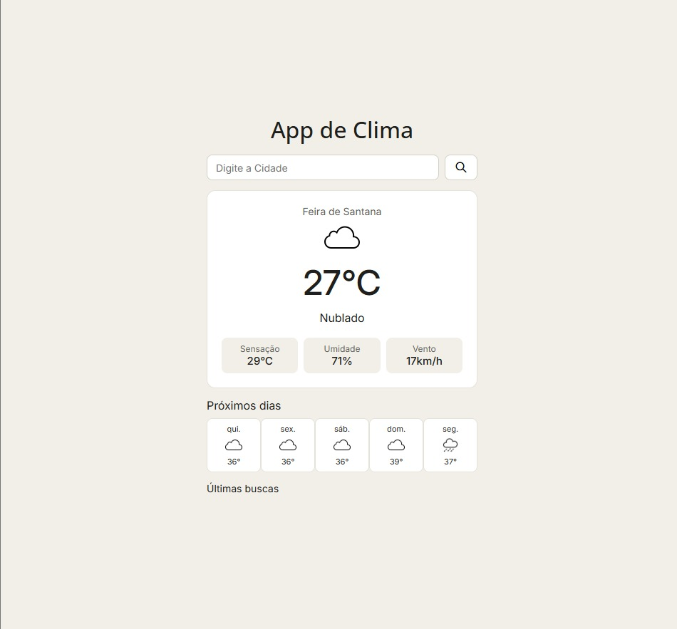
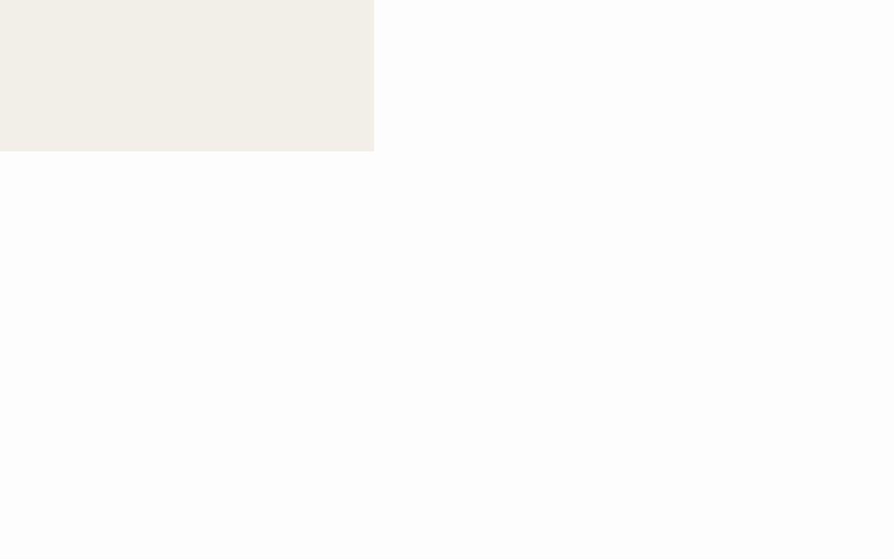

# 🌤️ App de Clima

Aplicação web para consulta de condições meteorológicas em tempo real, desenvolvida utilizando HTML, CSS e JavaScript.

## 🚀 Funcionalidades

- 🔎 Pesquisa meteorológica por cidade.
- 🌡️ Consulta de temperatura atual.
- 💧 Exibição da umidade do ar.
- 💨 Velocidade do vento.
- 🌥️ Condições climáticas.
- 🕘 Histórico de pesquisas.
- ⚠️ Tratamento de erros e cidades não encontradas.
- 🔄 Atualização dinâmica das informações.

## 🛠️ Tecnologias utilizadas

- HTML5
- CSS3
- JavaScript
- API meteorológica
- Fetch API
- LocalStorage

## 📸 Demonstração

## 🎬 Demonstração animada

## 💻 Como executar

1. Clone este repositório.
2. Abra a pasta do projeto.
3. Execute o arquivo `index.html` no navegador.

## 📚 Objetivo

Projeto desenvolvido para praticar JavaScript, consumo de APIs REST, manipulação do DOM, armazenamento local e tratamento de requisições assíncronas.

---

Desenvolvido por **Gabriel Oliveira**.